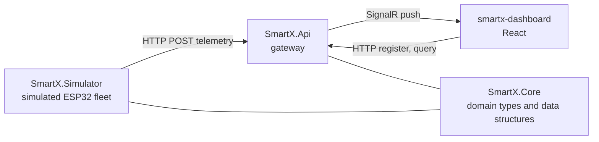

# Smart-X IoT Mesh Ecosystem

Data ingestion and validation gateway for a distributed ESP32 sensor network.

PROG7312 Programming 3B, Portfolio of Evidence Part 1.

The gateway receives multi-typed telemetry (float soil moisture, int wattage, bool valve state)
from a simulated fleet, validates it, retains a recent window per node, and pushes live state to a
React dashboard over SignalR.

---

## Prerequisites

| | Version used |
|---|---|
| .NET SDK | 10.0.401 |
| Node.js | 22.22.2 |

---

## Running it

Three processes. Start the API first.

**1. Restore and build**

```bash
dotnet restore
dotnet build
```

**2. Gateway API** (listens on `http://localhost:5225`)

```bash
cd SmartX.Api
dotnet run
```

**3. Sensor simulator** (new terminal)

```bash
cd SmartX.Simulator
dotnet run
```

**4. Dashboard** (new terminal, opens on `http://localhost:5173`)

```bash
cd smartx-dashboard
npm install
npm run dev
```

Open `http://localhost:5173` and choose **Sensor Data Ingestion and Telemetry**.

### Running with Docker

One command starts all three. Requires Docker Desktop to be running.

```bash
docker compose up --build
```

The first build takes a few minutes while the .NET and Node images download. After that it is
cached.

#### Then open the dashboard

**http://localhost:8080**

That is the whole UI. Click **Sensor Data Ingestion and Telemetry** to reach the Heartbeat Wall.

Note this is port **8080**, not 5173. The Vite dev server is not used in Docker; nginx serves the
built dashboard instead. The gateway itself is on `http://localhost:5225` if you want to hit the
API directly, but the dashboard proxies it, so you do not need to.

#### Watching the logs

Run in the foreground (no `-d`) and all three services print to your terminal, prefixed with the
service name:

```
api-1        | info: Microsoft.Hosting.Lifetime[14] Now listening on: http://[::]:8080
simulator-1  | info: SmartX.Simulator.Worker[0] Registered 24 sensors
simulator-1  | info: SmartX.Simulator.Worker[0] Published 24 readings (0 silent, 0 spiking)
api-1        | info: StalenessSweeper[0] VALVE-Z2S1-04 is now Stale
```

For one service on its own, in a second terminal:

```bash
docker compose logs -f simulator
docker compose logs -f api
docker compose logs -f dashboard
```

`-f` follows the output. Drop it to see what has happened so far and exit.

Useful things to look for:

| Log line | Where | Means |
|---|---|---|
| `Registered 24 sensors` | simulator | the fleet is known to the gateway |
| `Published N readings` | simulator | telemetry is flowing |
| `... is now Stale` | api | the sweeper spotted a silent node |

#### Stopping

If it is running in the foreground, `Ctrl+C`. Then:

```bash
docker compose down
```

Uploaded attachments live in a named volume, so `docker compose down` keeps them. Add `-v` to
delete them as well.

**Optional.** Attachments are AES encrypted at rest. Without a key the gateway generates a
temporary one, which means uploads stop being readable after a restart. To keep them, create a
`.env` file next to `docker-compose.yml`:

```
ATTACHMENTS_KEY=<base64 32 bytes>
```

---

## Architecture



`SmartX.Core` holds the domain types and data structures and depends on nothing. The API and the
simulator both reference it, which is what stops the two ends drifting apart. They never reference
each other, because they are meant to talk at runtime over HTTP rather than at compile time.

---

## Where each technical requirement lives

| Requirement | File |
|---|---|
| Generics, no boxing | `SmartX.Core/TelemetryPacket.cs` |
| Operator overloading | `SmartX.Core/AggregateReadings.cs` |
| Jagged arrays into `List<T>` | `SmartX.Core/TelemetryBatchBuffer.cs` |
| Custom collection | `SmartX.Core/TelemetryRingBuffer.cs` |
| Recursion with depth guard | `SmartX.Core/DeploymentTree.cs` |
| Sensor registration and validation | `SmartX.Api/Endpoints/SensorEndpoints.cs` |
| Encrypted file upload | `SmartX.Core/AttachmentStore.cs` |
| Engagement feature | `smartx-dashboard/src/components/HeartbeatWall.tsx` |

A few notes on the less obvious ones:

**`TelemetryPacket<T>`** is a `readonly struct` constrained to value types, so one type carries
float, int and bool without boxing. Closed generics cannot travel over HTTP, so the wire DTO tags
its payload with a value kind and the gateway switches on that tag to rebuild the right type.

**Operators cannot live on `TelemetryPacket<T>`.** That type accepts `bool`, while `+` needs
`INumber<T>`, and one type cannot carry both constraints. So numeric aggregation uses
`MeterReading<T>` with `+ - > <`, and actuators use `ActuatorReading` with `&` and `|`, which
answer whether all valves are open or any are.

**The recursion does two walks.** Down the deployment tree to validate placement, catching
duplicate node ids, orphaned levels and anything past the depth limit. Back up it to aggregate, so
a zone's power draw is the sum of its children. That second walk is what uses the operators.

---

## The engagement feature

The Heartbeat Wall, chosen in the Task 1 research. Each registered sensor is a tile carrying two
independent visual channels:

- **Hue** encodes the threshold band (Normal, Caution, Alert)
- **Opacity and pulse** encode data freshness (Live, Dimmed, Stale)

Keeping them separate matters because the most common mistake in telemetry work is confusing a bad
reading with a dead sensor. A spiking node and a silent node never look alike.

Normal tiles carry no colour at all, so a single alerting tile is the only saturated thing on a
full wall. Every tile also carries a text label, so nothing depends on colour alone.

A disconnect generates no traffic, so nothing request-driven can detect one. `StalenessSweeper`
runs on a timer, compares each node's last-seen time against its own expected interval, and pushes
the change. It is the only thing that can turn silence into an event.

To see it, open a node and press **Silence this node**, then go back to the wall. The tile fades to
stale within about three seconds while the simulator keeps publishing, unaware.

---

## API

| Method | Route |
|---|---|
| POST | `/api/sensors` |
| GET, DELETE | `/api/sensors/{nodeId}` |
| POST | `/api/telemetry`, `/api/telemetry/batch` |
| GET | `/api/telemetry/{nodeId}` |
| GET | `/api/topology` |
| POST, DELETE | `/api/debug/silence/{nodeId}` |
| POST, GET | `/api/sensors/{nodeId}/attachments` |
| GET, DELETE | `/api/attachments/{id}` |
| GET | `/health`, `/openapi/v1.json` |

`SmartX.Api/SmartX.Api.http` has ready-made requests for all of these, including the rejection
cases. Open it in Visual Studio and click **Send request** with the API running.

---

## Configuration

**Fleet size and behaviour**, in `SmartX.Simulator/appsettings.json`:

```json
"Zones": 3, "SubZonesPerZone": 2, "SensorsPerSubZone": 4,
"PublishIntervalMs": 1000, "SpikeChance": 0.02, "SilenceChance": 0.005
```

**Attachment encryption key.** Uploads are AES encrypted at rest. Without a configured key the API
generates a temporary one and logs a warning, which means uploads will not survive a restart. To
set a persistent key:

```bash
dotnet user-secrets set "Attachments:Key" "<base64 32 bytes>" --project SmartX.Api
```

---
