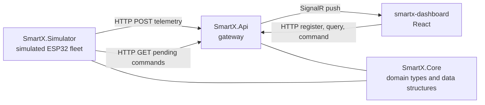
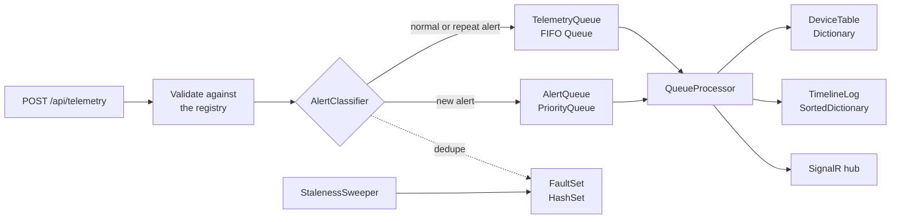

# Smart-X IoT Mesh Ecosystem

Ingestion gateway, real-time command stream and device management for a distributed ESP32 sensor
network.

PROG7312 Programming 3B, Portfolio of Evidence Part 1 and Part 2.

The gateway receives multi-typed telemetry (float soil moisture, int wattage, bool actuator state)
from a simulated fleet that behaves like real devices. Packets are validated, pushed through a FIFO
queue (or a priority queue when they are critical), stored in the right data structure for how they
get read back, and streamed live to a React dashboard over SignalR. Operators can override valves,
pumps and relays with a full undo history, search the fleet, and act on suggestions from a
predictive action engine that learns from what they do.

---

## Prerequisites

| | Version used |
|---|---|
| .NET SDK | 10.0.401 |
| Node.js | 22.22.2 |
| Docker Desktop (optional) | 29.6 |

---

## Running it

Three processes. Start the API first.

**1. Restore and build**

```bash
dotnet restore
dotnet build
```

**2. Gateway API** (listens on `http://localhost:5225`)

```bash
cd SmartX.Api
dotnet run
```

**3. Sensor simulator** (new terminal)

```bash
cd SmartX.Simulator
dotnet run
```

**4. Dashboard** (new terminal, opens on `http://localhost:5173`)

```bash
cd smartx-dashboard
npm install
npm run dev
```

Open `http://localhost:5173`. The nav bar at the top reaches every module from any page:

- **Telemetry** is the Part 1 Heartbeat Wall
- **Command Stream** is the Part 2 dashboard
- **Topology** is locked until the final PoE

### Running with Docker

One command starts all three. Requires Docker Desktop to be running.

```bash
docker compose up --build
```

The first build takes a few minutes while the .NET and Node images download. After that it is
cached.

#### Then open the dashboard

**http://localhost:8080**

That is the whole UI. Note this is port **8080**, not 5173. The Vite dev server is not used in
Docker; nginx serves the built dashboard instead and proxies the API and the SignalR hub, so the
browser only ever talks to one origin. The gateway itself is on `http://localhost:5225` if you want
to hit the API directly.

#### Stopping

If it is running in the foreground, `Ctrl+C`. Then:

```bash
docker compose down
```

Uploaded attachments live in a named volume, so `docker compose down` keeps them. Add `-v` to
delete them as well.

**Optional.** Attachments are AES encrypted at rest. Without a key the gateway generates a
temporary one, which means uploads stop being readable after a restart. To keep them, create a
`.env` file next to `docker-compose.yml`:

```
ATTACHMENTS_KEY=<base64 32 bytes>
```

---

## Architecture



`SmartX.Core` holds the domain types and data structures and depends on nothing. The API and the
simulator both reference it, which is what stops the two ends drifting apart. They never reference
each other, because they are meant to talk at runtime over HTTP rather than at compile time.

### Inside the gateway



The endpoint only validates and enqueues, so a request never waits on storage or SignalR. The
processor checks the priority queue before every single FIFO packet, so a critical alert waits
behind at most one normal packet no matter how big the backlog is.

---

## Where each technical requirement lives

### Part 1

| Requirement | File |
|---|---|
| Generics, no boxing | `SmartX.Core/TelemetryPacket.cs` |
| Operator overloading | `SmartX.Core/AggregateReadings.cs` |
| Jagged arrays into `List<T>` | `SmartX.Core/TelemetryBatchBuffer.cs` |
| Custom collection | `SmartX.Core/TelemetryRingBuffer.cs` |
| Recursion with depth guard | `SmartX.Core/DeploymentTree.cs` |
| Sensor registration and validation | `SmartX.Api/Endpoints/SensorEndpoints.cs` |
| Encrypted file upload | `SmartX.Core/AttachmentStore.cs` |
| Engagement feature | `smartx-dashboard/src/components/HeartbeatWall.tsx` |

### Part 2

| Requirement | Data structure | File |
|---|---|---|
| FIFO telemetry processing | `Queue<TelemetryPacketDto>` | `SmartX.Core/TelemetryQueue.cs`, `SmartX.Api/QueueProcessor.cs` |
| Critical alerts bypass the queue | `PriorityQueue<AlertWork, (int, long)>` | `SmartX.Core/AlertQueue.cs`, `SmartX.Core/AlertClassifier.cs` |
| Undo for manual overrides | `Stack<DeviceCommand>` | `SmartX.Core/CommandHistory.cs` |
| Live device lookups | `Dictionary<string, DeviceState>` | `SmartX.Core/DeviceTable.cs` |
| Logs ordered by timestamp | `SortedDictionary<DateTimeOffset, ...>` | `SmartX.Core/TimelineLog.cs` |
| Unique error states and disconnects | `HashSet<string>`, `HashSet<(string, AlertKind, AlertSeverity)>` | `SmartX.Core/FaultSet.cs` |
| Commands waiting for a device | `Dictionary<string, Queue<PendingCommandDto>>` | `SmartX.Core/CommandOutbox.cs` |
| Pattern analysis | `Dictionary<string, Dictionary<string, int>>` | `SmartX.Core/PatternLearner.cs` |
| Ranked suggestions | `PriorityQueue<InsightDto, int>` | `SmartX.Core/InsightEngine.cs`, `SmartX.Api/InsightPublisher.cs` |
| Navigation without losing state | React context providers | `smartx-dashboard/src/context/`, `components/AppShell.tsx` |
| Search and filter | server side over the device dictionary | `SmartX.Api/Endpoints/DeviceEndpoints.cs`, `components/DeviceFinder.tsx` |

---

## The Command Stream page

The second module on the dashboard, at `/commands`.

| Panel | What it does |
|---|---|
| Stats strip | Queue depth, packets per second, how many alerts jumped the queue, critical count, disconnected nodes, duplicates blocked |
| Device timeline | Graph of any device from the sorted timeline, with the alert thresholds drawn on, a hover crosshair and 5 min, 15 min or all ranges |
| Manual overrides | Every valve, pump and relay grouped by sub-zone, with a shut all valves button that needs a second click |
| Live packet stream | The latest packets coming off the queue, with a pause button |
| Suggested actions | Ranked suggestions from the engine, each with Apply, Show and Dismiss, kept at the bottom of the main column so its changing size never shifts the panels above |
| Find a device | Search by node id or location, filter by category and alert state, flagged devices float to the top |
| Command history | The undo stack, the undo button says what it will revert, `Ctrl+Z` works too |
| Priority alerts | Worst first then newest, the same order the priority queue handles them, showing which are still active |
| History | Alerts, commands, undos and dropouts from the sorted event log |

The packet feed, alerts, history and suggestions live in context providers above the router, so
they keep filling up while you are on another page. Moving between Telemetry and Command Stream
never reloads the fleet or drops the SignalR connection. The selected device and time range sit in
the URL, and the search filters are kept for the session.

---

## Predictive action engine

`InsightEngine` combines two passes and ranks the result.

**Rule pass.** Everything currently in the fault sets gets matched to an actuator in the same
sub-zone that could fix it.

| Problem | Suggestion |
|---|---|
| Soil too dry | Start the pump, open a closed valve |
| Soil flooding | Close the open valve, or stop the pump if there is no valve |
| Critical power spike | Cut power at the relay |
| Device disconnected | Check it, including how many commands are waiting for it |

If nothing nearby can help, it points at the device instead, for example "Check the drip line" when
the pump is already running but the soil is still dry.

**Learned pass.** `PatternLearner` keeps a weighted graph of "after X the operator did Y". Alerts,
searches, opened devices and commands are all recorded. Alerts can only start a pattern, because
the point is to learn from the operator, not from the network. Two things are linked if they
happened within two minutes of each other, and a pattern has to be seen at least twice before it
counts. Confidence is how often Y followed X out of everything that followed X.

When one of those triggers is happening right now (an active alert, or the operator's last action),
the strongest followers become suggestions. So if you keep checking `PUMP-Z1S1-01` whenever
`SOIL-Z1S1-04` goes dry, the next time it goes dry the pump is suggested before you search for it.

**Ranking.** Rules score by severity (critical 90, warning 65). Learned suggestions score by
confidence and how often they were seen. When a rule and a learned pattern suggest the same thing
they merge into one "Rule + learned" suggestion with a bump. Everything goes into a
`PriorityQueue` and the top eight come out. `InsightPublisher` rebuilds the list every two seconds
and only pushes it over SignalR when it actually changed.

The dashboard flags the devices involved in the finder and the override panel, and the nav bar
shows how many suggestions are open from any page. Opening **What the engine has learned** under
the suggestions shows the raw patterns.

**Known limitation.** Every alert active at the time of an operator action gets linked to it, so
when several alerts are active together some weak links get learned too. They end up with low
confidence and rank below the real patterns, but the reason text on a learned suggestion can name
the weaker trigger.

---

## API

### Part 1

| Method | Route |
|---|---|
| POST | `/api/sensors` |
| GET, DELETE | `/api/sensors/{nodeId}` |
| POST | `/api/telemetry`, `/api/telemetry/batch` |
| GET | `/api/telemetry/{nodeId}` |
| GET | `/api/topology` |
| POST, DELETE | `/api/debug/silence/{nodeId}` |
| POST, GET | `/api/sensors/{nodeId}/attachments` |
| GET, DELETE | `/api/attachments/{id}` |
| GET | `/health`, `/openapi/v1.json` |

### Part 2

| Method | Route | Returns |
|---|---|---|
| GET | `/api/stream/stats` | queue depth, throughput, alert counts |
| GET | `/api/stream/alerts?limit=` | recent alerts, newest first |
| GET | `/api/stream/faults` | disconnected nodes, active errors, duplicates blocked |
| GET | `/api/stream/timeline/{nodeId}?from=&to=&limit=` | timestamp ordered readings |
| GET | `/api/stream/events?nodeId=&limit=` | history of alerts, commands and dropouts |
| GET | `/api/devices?category=&alertState=&search=` | live device table, worst first |
| GET | `/api/devices/{nodeId}` | one device |
| POST | `/api/commands` | issue an override (202, the device applies it on check in) |
| POST | `/api/commands/undo` | revert the last command (409 when the stack is empty) |
| GET | `/api/commands/history` | the undo stack and what undo would revert |
| GET | `/api/commands/pending/{nodeId}` | what a device collects when it checks in |
| GET | `/api/insights` | ranked suggestions |
| POST | `/api/insights/activity` | record a search or opened device |
| POST | `/api/insights/{id}/dismiss` | hide a suggestion for 10 minutes |
| GET | `/api/insights/patterns` | what the engine has learned |

SignalR pushes on `/hub/telemetry`: `ReadingReceived`, `LivenessChanged`, `AlertRaised`,
`EventLogged`, `CommandIssued`, `CommandReverted` and `InsightsUpdated`.

`SmartX.Api/SmartX.Api.http` has ready-made requests for all of these in order, including the
rejection cases. Open it in Visual Studio and click **Send request** with the API running.

---

## Configuration

**Fleet size and behaviour**, in `SmartX.Simulator/appsettings.json`:

```json
"Zones": 3, "SubZonesPerZone": 2, "SensorsPerSubZone": 4,
"PublishIntervalMs": 1000, "SpikeChance": 0.02, "DropChance": 0.02,
"DryingRate": 0.04, "SilenceChance": 0.005, "RecoverChance": 0.1
```

`DryingRate` is how fast soil moves towards wet or dry each reading. Raise it to make the effect of
an override show up faster in a demo.

**Attachment encryption key.** Uploads are AES encrypted at rest. Without a configured key the API
generates a temporary one and logs a warning, which means uploads will not survive a restart. To
set a persistent key:

```bash
dotnet user-secrets set "Attachments:Key" "<base64 32 bytes>" --project SmartX.Api
```

---
