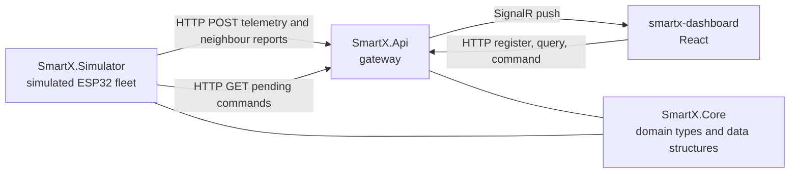
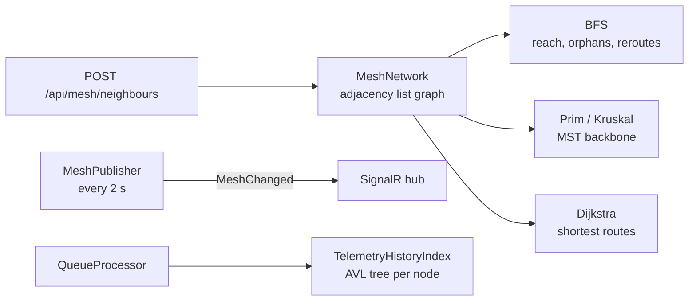

# Smart-X IoT Mesh Ecosystem

Ingestion gateway, real-time command stream and self-healing mesh routing for a simulated ESP32
sensor network.

PROG7312 Programming 3B, Portfolio of Evidence Part 1, Part 2 and the final PoE (Part 3).

A simulated fleet posts multi-typed telemetry (float soil moisture, int wattage, bool actuator state)
to a .NET 10 gateway, which validates it, queues it and streams it live to a React dashboard over
SignalR. The final PoE adds **Network Topology and Mesh Routing**: every node beacons the neighbours
it can hear, the gateway builds a weighted graph of the mesh, finds who is reachable with BFS, works
out the most power efficient backbone with Prim's (checked by Kruskal's) and heals routes live when
a relay drops. Every reading is also indexed in a per-node AVL tree so any time range comes back
without scanning the whole history.

---

## Prerequisites

| | Version used |
|---|---|
| .NET SDK | 10.0.401 |
| Node.js | 22.22.2 |
| Docker Desktop (optional) | 29.6 |

---

## Running it

Three processes. Start the API first.

**1. Restore and build**

```bash
dotnet restore
dotnet build
```

**2. Gateway API** (listens on `http://localhost:5225`)

```bash
cd SmartX.Api
dotnet run
```

**3. Sensor simulator** (new terminal)

```bash
cd SmartX.Simulator
dotnet run
```

**4. Dashboard** (new terminal)

```bash
cd smartx-dashboard
npm install
npm run dev
```

Open `http://localhost:5173`. The gateway seeds 24 hours of history for every node on startup, so the
historical log has data straight away. Give the map a few seconds after the simulator starts for the
first neighbour reports to arrive.

### Running the tests

```bash
dotnet test
```

42 xUnit tests in `SmartX.Tests` cover the AVL tree, the history index, BFS, the heap, union find
and all three spanning trees, including Prim against Kruskal on 200 random meshes.

### Running with Docker

```bash
docker compose up --build
```

Then open **http://localhost:8080** (not 5173). nginx serves the built dashboard and proxies the API
and SignalR hub. The API is still on `http://localhost:5225` if you want to call it directly. Stop it
with `Ctrl+C` and `docker compose down` (add `-v` to also delete uploaded attachments).

---

## Using the dashboard

The nav bar at the top reaches all three modules from any page, and each module keeps its state
when you move between them.

### Telemetry (Part 1)

Register a sensor with its MAC, location and category, then drill down the Heartbeat Wall zone by
zone. Live tiles pulse, and a tile fades and is marked stale when its node stops reporting.
Click a tile for the node page, where you can attach config files, photos or logs, and silence the
node to test a disconnect.

### Command Stream (Part 2)

| Panel | What it does |
|---|---|
| Stats strip | Queue depth, packets per second, alerts that jumped the queue, disconnected nodes |
| Device timeline | Graph of any device from the sorted timeline, with the alert thresholds drawn on |
| Manual overrides | Every valve, pump and relay by sub-zone, plus shut all valves |
| Command history | The undo stack, `Ctrl+Z` works too |
| Find a device | Search by node id or location, filter by category and alert state |
| Priority alerts | Worst first, the same order the priority queue handles them |
| Suggested actions | Ranked suggestions from the predictive engine, each with Apply, Show and Dismiss |

### Topology (final PoE)

| Panel | What it does |
|---|---|
| Mesh map | Every node inside its zone, links shaded by signal strength. Layers switch between all links, the MST backbone, the shortest routes and BFS reach (hop count on every node) |
| Route tracer | Search by MAC in any format (`AA:BB:..`, `aa-bb-..`, `AABB..`) or node id, or click a node. Shows the MST route and the Dijkstra route with every hop's RSSI and cost, and draws both on the map |
| Reachability | BFS from the gateway or any node. Connected nodes by hop count, the down and orphaned lists, and "hop via X instead of Y" for nodes whose route ran through a down node |
| Historical log | Pick a node and a range (last hour, 6 h, 24 h, 14:00 to 16:00 or custom). Chart, raw log and the AVL query stats |
| Benchmark | Runs the same range query on the AVL tree and on a plain list at 1k to 1M readings |

The selected node and layer sit in the URL (`/topology?node=SOIL-Z3S2-01&layer=backbone`), so a
refresh or a link from the node page lands on the same view.

**Trying the self-healing**

1. Click a node in Zone 3, or type its MAC into the route tracer.
2. Hover a relay in the route and click **Silence**.
3. Within 2 seconds the map, both routes and the reachability panel update, and the tracer says
   what it healed around.
4. **Restore** (or **Restore all**) brings it back. **Clear** stops tracing.

---

## Architecture



`SmartX.Core` holds the data structures and depends on nothing. The API and simulator both reference
it but never each other, because they talk at runtime over HTTP like a real device would.



A node counts as down when its readings stop or it is silenced, so it drops out of BFS, both MSTs and
Dijkstra on the next publish and the dashboard redraws the healed routes.

---

## Where each technical requirement lives

### Part 1

| Requirement | File |
|---|---|
| Generics, no boxing | `SmartX.Core/TelemetryPacket.cs` |
| Operator overloading | `SmartX.Core/AggregateReadings.cs` |
| Jagged arrays into `List<T>` | `SmartX.Core/TelemetryBatchBuffer.cs` |
| Recursion | `SmartX.Core/DeploymentTree.cs` |
| File upload | `SmartX.Core/AttachmentStore.cs` |
| Engagement feature | `smartx-dashboard/src/components/HeartbeatWall.tsx` |

### Part 2

| Requirement | Data structure | File |
|---|---|---|
| FIFO telemetry processing | `Queue<T>` | `SmartX.Core/TelemetryQueue.cs` |
| Critical alerts bypass the queue | `PriorityQueue<T, P>` | `SmartX.Core/AlertQueue.cs` |
| Undo for manual overrides | `Stack<T>` | `SmartX.Core/CommandHistory.cs` |
| Live device lookups | `Dictionary<TKey, TValue>` | `SmartX.Core/DeviceTable.cs` |
| Logs ordered by timestamp | `SortedDictionary<TKey, TValue>` | `SmartX.Core/TimelineLog.cs` |
| Unique errors and disconnects | `HashSet<T>` | `SmartX.Core/FaultSet.cs` |
| Predictive action engine | weighted pattern graph and `PriorityQueue` | `SmartX.Core/PatternLearner.cs`, `SmartX.Core/InsightEngine.cs` |

### Final PoE

| Requirement | Data structure | File |
|---|---|---|
| Historical range queries | `AvlTree<TelemetryKey, double>` | `SmartX.Core/AvlTree.cs`, `SmartX.Core/TelemetryHistoryIndex.cs` |
| Mesh network model | adjacency list graph | `SmartX.Core/MeshGraph.cs`, `SmartX.Core/MeshNetwork.cs` |
| Connected devices, who is down, where to hop | BFS with a `Queue<string>` | `SmartX.Core/MeshTraversal.cs`, `SmartX.Core/MeshReachability.cs` |
| Power efficient routing (MST) | Prim's with a binary heap | `SmartX.Core/PrimMst.cs`, `SmartX.Core/MinHeap.cs` |
| MST cross check | Kruskal's with union find | `SmartX.Core/KruskalMst.cs`, `SmartX.Core/DisjointSet.cs` |
| Each node's cheapest route | Dijkstra | `SmartX.Core/DijkstraRoutes.cs` |
| Lookup by MAC address | `ConcurrentDictionary<MacAddress, string>` | `SmartX.Core/SensorRegistry.cs` |
| Topology page | SVG map, tracer, BFS panel, history viewer | `smartx-dashboard/src/pages/TopologyPage.tsx` |

---

## Data structures behind the topology module

The separate Data Structures report goes into more depth. This is the short version.

### AVL tree for historical telemetry

**Role.** Each node gets its own `AvlTree<TelemetryKey, double>` keyed on timestamp plus a sequence
number, so two readings at the same tick are both kept. A plain BST's shape depends on the order the
keys are inserted (Sedgewick and Wayne, n.d.), and when it becomes skewed its operations cost O(n)
(GeeksforGeeks, 2026a). Telemetry always arrives in time order, which is exactly that case. An AVL
tree rebalances after every insert, so its height is always O(log n) (GeeksforGeeks, 2026a).

**Range query.** It walks down to the start of the window and then only visits nodes inside it:

```csharp
// Only go left if smaller keys could still be in the window, same idea on the right
if (aboveFrom)
{
    visited += CollectRange(node.Left, from, to, into);
}

if (_comparer.Compare(node.Key, from) >= 0 && _comparer.Compare(node.Key, to) <= 0)
{
    into.Add(Pair(node));
}

if (belowTo)
{
    visited += CollectRange(node.Right, from, to, into);
}
```

Because the height stays O(log n), a query for k readings costs O(log n + k) instead of the O(n) of
scanning a list. The oldest reading is always the leftmost node, so keeping a day of history (86,400
readings per node) is just a delete-min. The Benchmark panel on the Topology page runs the same query
on the tree and on a list so the difference can be seen live.

**How it scales** (from `GET /api/history/benchmark`, same 10 minute window, 50 runs at each size,
Debug build):

| Readings | Tree height | Results | AVL | Nodes visited | List scan | Faster |
|---|---|---|---|---|---|---|
| 1,000 | 12 | 600 | 80 µs | 608 | 25 µs | 0.3× |
| 10,000 | 16 | 600 | 77 µs | 612 | 180 µs | 2.3× |
| 100,000 | 20 | 600 | 128 µs | 617 | 1,612 µs | 12.6× |
| 1,000,000 | 24 | 600 | 193 µs | 620 | 15,077 µs | 78.1× |

The tree's time barely moves as the history grows a thousand times, because it only touches one path
plus the results. The list has to look at every reading. Under a few thousand readings the flat list
still wins because it is so cache friendly.

### Weighted graph of the mesh

**Role.** Vertices are the nodes and the gateway, edges are the radio links they report. The graph
is an adjacency list, which uses less space than an adjacency matrix for a sparse graph and makes a
node's neighbours available directly (GeeksforGeeks, 2025a). Here it is a dictionary of
dictionaries, so adding or finding a link is O(1) and walking a node's neighbours is O(degree).

**Link cost.** The cost is based on the expected transmission count (ETX) metric. According to
De Couto et al. (2005), ETX counts how many transmissions, including retransmissions, a packet needs
to get across a link, and it finds better paths than minimum hop count because it avoids lossy
links. Thread estimates link quality from the received signal strength (RSSI) in the same way
(Silicon Labs, n.d.a), so Smart-X turns each link's RSSI into a delivery quality and uses its
inverse as the cost:

```csharp
double quality = (double)(rssiDbm - SensitivityDbm) / (StrongDbm - SensitivityDbm);
quality = Math.Clamp(quality, 0.05, 1);

double expectedTransmissions = 1 / quality;

return Math.Round(BaseHopCost * expectedTransmissions, 2);
```

A -50 dBm link costs 10 and a -80 dBm link costs 40, because it needs about four tries per packet.
Links expire after 15 seconds without a report.

### BFS, MST and Dijkstra

| Algorithm | Used for | Time |
|---|---|---|
| BFS (`Queue<string>`) | everything reachable from the gateway or a node, hop counts, orphans, reroutes | O(V + E) (GeeksforGeeks, 2026b) |
| Prim (binary heap) | the MST backbone, the least total radio energy that keeps everyone connected | O((V + E) log V) (GeeksforGeeks, 2026e) |
| Kruskal (union find) | independent check that Prim's total is right | O(E log E) (GeeksforGeeks, 2026d) |
| Dijkstra (same heap) | each node's own cheapest route to the gateway | O((V + E) log V) (GeeksforGeeks, 2026c) |

All of them skip down nodes, which is what makes the routes heal. Zigbee works the same way: when a
route breaks, route discovery runs again without the damaged node, which gives a different route
(Silicon Labs, n.d.b).

An MST has no source or destination, it only connects every node for the least total cost
(GeeksforGeeks, 2025b). That means a far node can end up on a long chain (12 hops, cost 300.35 for
`SOIL-Z3S2-01`), while Dijkstra minimises each node's own route (5 hops, cost 173.96 for the same
node). The tracer shows both: the MST is the power efficient backbone the brief asks for, and
Dijkstra is closer to real mesh protocols, where a path's cost is the sum of its link costs and the
cheapest links are chosen (Silicon Labs, n.d.b), and each router keeps a next hop for every
destination (Silicon Labs, n.d.a).

---

## API

`SmartX.Api/SmartX.Api.http` has ready-made requests for every route in order, including the
rejection cases. Open it in Visual Studio or VS Code (REST Client) and click **Send request** with
the API running.

### Final PoE

| Method | Route | Returns |
|---|---|---|
| POST | `/api/mesh/neighbours` | a node's neighbour report |
| GET | `/api/mesh` | nodes with position and state, every link with RSSI and cost |
| GET | `/api/mesh/reach?from=&zone=` | BFS: connected, down and orphaned nodes |
| GET | `/api/mesh/reroutes` | nodes whose usual route runs through a down node, and their new next hop |
| GET | `/api/mesh/mst?algorithm=` | the MST (`prim` or `kruskal`) with its total cost |
| GET | `/api/mesh/mst/compare` | Prim and Kruskal on the same snapshot |
| GET | `/api/mesh/shortest` | the Dijkstra shortest path tree |
| GET | `/api/mesh/route/{nodeIdOrMac}` | backbone route, shortest route and what it healed around |
| GET | `/api/history/{nodeIdOrMac}?from=&to=` | readings in the range plus the AVL query stats |
| GET | `/api/history/benchmark` | AVL range query against a list scan |

### Parts 1 and 2

| Area | Routes |
|---|---|
| Sensors | `/api/sensors`, `/api/sensors/{nodeId}`, `/api/sensors/{nodeId}/attachments` |
| Telemetry | `/api/telemetry`, `/api/telemetry/batch`, `/api/telemetry/{nodeId}` |
| Stream | `/api/stream/stats`, `/api/stream/alerts`, `/api/stream/faults`, `/api/stream/timeline/{nodeId}`, `/api/stream/events` |
| Devices | `/api/devices`, `/api/devices/{nodeId}` |
| Commands | `/api/commands`, `/api/commands/undo`, `/api/commands/history`, `/api/commands/pending/{nodeId}` |
| Insights | `/api/insights`, `/api/insights/activity`, `/api/insights/{id}/dismiss`, `/api/insights/patterns` |
| Other | `/api/debug/silence/{nodeId}`, `/health`, `/openapi/v1.json` |

Live updates are pushed on the SignalR hub at `/hub/telemetry`.

---

## Configuration

**Fleet**, in `SmartX.Simulator/appsettings.json`: `Zones`, `SubZonesPerZone` and
`SensorsPerSubZone` set the fleet size. Set `SilenceChance` to 0 for a demo where nodes only drop
when you silence them.

**History seeding**, in `SmartX.Api/appsettings.json`: `"History": { "SeedHours": 24,
"SeedIntervalSeconds": 10 }` gives 8,640 readings per node on startup.

**Attachment key.** Uploads are AES encrypted at rest. Without a key the API makes a temporary one,
so uploads are unreadable after a restart. To keep them, set a key:

```bash
dotnet user-secrets set "Attachments:Key" "<base64 32 bytes>" --project SmartX.Api
```

In Docker, put `ATTACHMENTS_KEY=<base64 32 bytes>` in a `.env` file next to `docker-compose.yml`.

---

## References

De Couto, D.S.J., Aguayo, D., Bicket, J. and Morris, R. 2005. A high-throughput path metric for multi-hop wireless routing, Wireless Networks, 11, pp. 419-434. [Journal]. Available at: https://ocw.cs.pub.ro/courses/_media/isrm/articole/etx_2003.pdf [Accessed 12 November 2026].

GeeksforGeeks. 2025a. Adjacency list representation, GeeksforGeeks, 23 July 2025. [Blog]. Available at: https://www.geeksforgeeks.org/dsa/adjacency-list-meaning-definition-in-dsa/ [Accessed 12 November 2026].

GeeksforGeeks. 2025b. Difference between minimum spanning tree and shortest path, GeeksforGeeks, 23 July 2025. [Blog]. Available at: https://www.geeksforgeeks.org/difference-between-minimum-spanning-tree-and-shortest-path/ [Accessed 12 November 2026].

GeeksforGeeks. 2026a. AVL tree data structure, GeeksforGeeks, 2 November 2026. [Blog]. Available at: https://www.geeksforgeeks.org/dsa/introduction-to-avl-tree/ [Accessed 12 November 2026].

GeeksforGeeks. 2026b. Breadth first search or BFS for a graph, GeeksforGeeks, 17 October 2026. [Blog]. Available at: https://www.geeksforgeeks.org/dsa/breadth-first-search-or-bfs-for-a-graph/ [Accessed 12 November 2026].

GeeksforGeeks. 2026c. Dijkstra's algorithm, GeeksforGeeks, 25 October 2026. [Blog]. Available at: https://www.geeksforgeeks.org/dsa/dijkstras-shortest-path-algorithm-greedy-algo-7/ [Accessed 12 November 2026].

GeeksforGeeks. 2026d. Kruskal's minimum spanning tree (MST) algorithm, GeeksforGeeks, 10 July 2026. [Blog]. Available at: https://www.geeksforgeeks.org/dsa/kruskals-minimum-spanning-tree-algorithm-greedy-algo-2/ [Accessed 12 November 2026].

GeeksforGeeks. 2026e. Prim's algorithm for minimum spanning tree (MST), GeeksforGeeks, 2 November 2026. [Blog]. Available at: https://www.geeksforgeeks.org/dsa/prims-minimum-spanning-tree-mst-greedy-algo-5/ [Accessed 12 November 2026].

Sedgewick, R. and Wayne, K. n.d. 3.2 Binary search trees, Algorithms 4th Edition. [Online]. Available at: https://algs4.cs.princeton.edu/32bst/ [Accessed 12 November 2026].

Silicon Labs. n.d.a. Routing and network connectivity, Silicon Labs OpenThread Documentation. [Online]. Available at: https://docs.silabs.com/openthread/2.7.0/thread-fundamentals/05-routing-and-network-connectivity [Accessed 12 November 2026].

Silicon Labs. n.d.b. Table routing, Silicon Labs Zigbee Documentation. [Online]. Available at: https://docs.silabs.com/zigbee/9.0.0/zigbee-concepts-network/table-routing [Accessed 12 November 2026].
